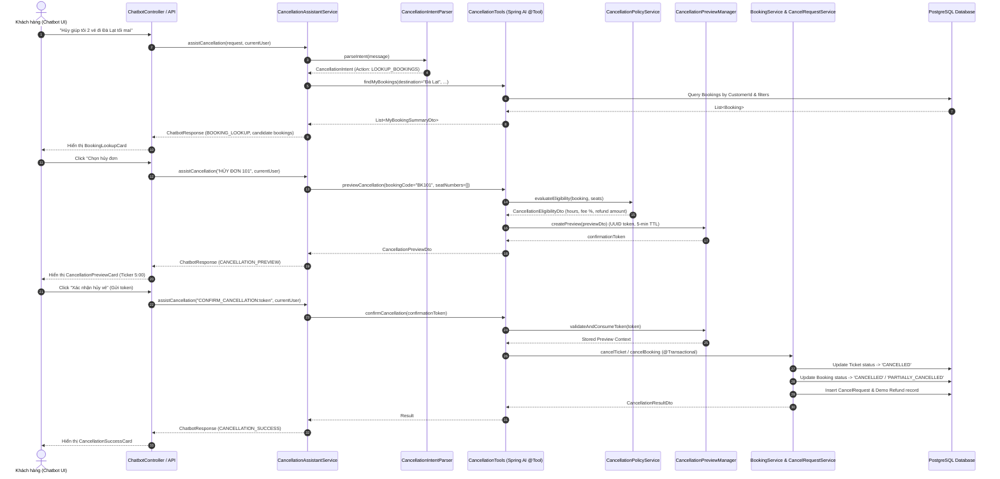

# Kiến trúc hệ thống AI Hỗ trợ hủy vé (AI Ticket Cancellation Architecture)

## 1. Sơ đồ luồng xử lý tổng thể



---

## 2. Nguyên tắc bảo mật và giải phóng ghế

### 2.1. Xác thực danh tính độc lập (Zero-Trust AI Identity)
- AI Model hoàn toàn không có quyền tự chuyển trạng thái cơ sở dữ liệu. Mọi thay đổi nghiệp vụ đều bắt buộc phải thông qua backend Java service.
- Định danh khách hàng được trích xuất trực tiếp từ `SecurityContextHolder.getContext().getAuthentication().getName()`. Mọi payload gửi từ AI tool hoặc client chứa `userId` hay `customerId` lạ đều bị phớt lờ và ghi đè bằng user thực tế đang đăng nhập.

### 2.2. Kiểm soát đồng thời và Chống Double-Click (Concurrency & Idempotency)
- `CancellationPreviewManager` quản lý `confirmationToken` (UUID ngẫu nhiên, TTL 300 giây).
- Khi người dùng bấm nút xác nhận nhiều lần liên tiếp (Double-Click / Network Retry), phương thức `consumeToken(token)` sử dụng cơ chế atomic lookup & invalidation.
- Kết quả hủy lần đầu được lưu trữ tạm thời trong `idempotencyResultMap` (TTL 10 phút). Các request trùng token đến sau sẽ nhận ngay kết quả đã xử lý thành công trước đó mà không bao giờ thực thi hủy hai lần hay hoàn tiền kép.

### 2.3. Cơ chế giải phóng ghế tức thì (Instant Seat Release)
Hệ thống quản lý trạng thái ghế đặt trong [TicketRepository.java](file:///d:/WWW/Nhom01_WWW_Backend/src/main/java/vn/edu/iuh/nhom01_www/ticket/repository/TicketRepository.java):
```java
@Query("SELECT t.seat.id FROM Ticket t WHERE t.trip.id = :tripId AND t.status IN ('ISSUED', 'RESERVED', 'USED')")
List<Long> findBookedSeatIdsByTripId(@Param("tripId") Long tripId);
```
Khi vé được chuyển sang trạng thái `CANCELLED`:
- Trạng thái `CANCELLED` ngay lập tức bị loại khỏi danh sách ghế đã đặt.
- Không cần xóa bản ghi vé khỏi cơ sở dữ liệu (đảm bảo tính toàn vẹn kiểm toán và lưu vết lịch sử hoàn tiền).
- Khách hàng khác tìm kiếm chuyến xe sẽ thấy ghế trống ngay lập tức trên sơ đồ xe.
