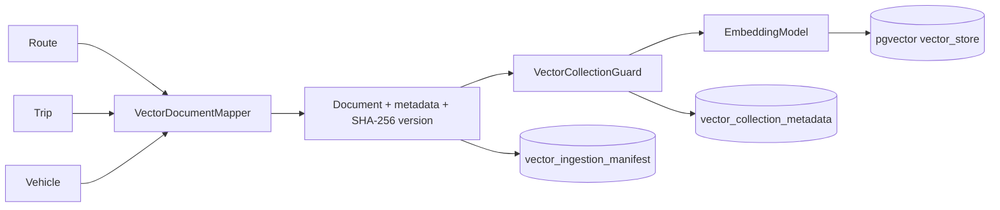
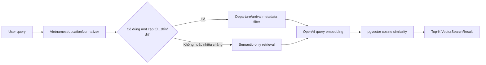
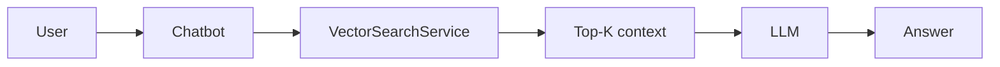

# Kiến trúc AI Vector

## Thành phần đã triển khai

| Thành phần | Vai trò |
|---|---|
| Spring Boot / Spring AI | Wiring profile `ai-vector`, OpenAI model và PgVectorStore |
| `VectorDocumentMapper` | Biến Route/Trip/Vehicle thành `Document`, metadata và stable document id |
| `VectorIngestionService` | Lập chỉ mục theo batch, idempotency, xóa chunk/source lỗi thời |
| `JdbcVectorIngestionStateStore` | Lưu manifest document version/chunk count |
| `JdbcVectorCollectionGuard` | Khóa read/write khi identity embedding không khớp |
| `PgVectorSearchService` | Top-K, threshold, source/route filters, directional filters |
| `VietnameseLocationNormalizer` | Canonical hóa alias như Sài Gòn → `tp hcm` |

## Luồng ingestion

`VectorIngestionService` chỉ chạy khi được gọi rõ ràng. Không có tự động ingest khi app khởi động.

## Luồng retrieval

Directional filter không suy luận trạng thái chuyến, ghế trống hoặc giá vé. Nó chỉ chặn kết quả đảo chiều khi query có một cặp điểm đi/đến không mơ hồ.

## Tích hợp RAG tương lai

Đây chỉ là hướng tích hợp. `ChatbotService` hiện chưa gọi `VectorSearchService` — **CHƯA TRIỂN KHAI**.

